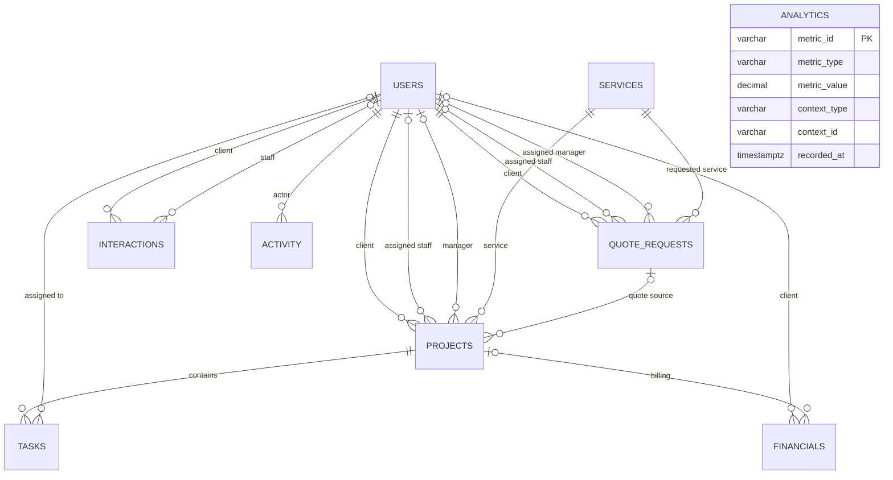

# CAMIS thesis diagrams and database tables

Update Chapter 3 from the checked-in `camis-bn/database.sql` and, before submission, compare it with the schema of the disposable database used for your defense. An existing installation can differ because `CREATE TABLE IF NOT EXISTS` does not upgrade columns. Regenerate Word captions, cross-references, figure/table lists and table of contents after revising. Keep the proposed design clearly labeled until the code and tests exist.

| Figure | Revision |
|---|---|
| 1 Existing system | Keep the verified Creative Saako workflow; mark manual register, communication and reporting bottlenecks confirmed by your field evidence. |
| 2 Use case | Show Client, Staff, Manager and Admin. Client submits/views own work; Staff handles assigned tasks and records interactions; Manager/Admin approves quotes and supervises work; Admin governs users and reviews audit. Add notifications only when implemented. |
| 3 Class diagram | If retained, use app domain objects and operations: User, QuoteRequest, Project, Task, Interaction, FinancialRecord and services for workflow/analytics. Do not draw an ORM or inheritance hierarchy the project does not use. |
| 4 and 7 Quote request | Signed-in client → select service → validate description, budget and date → insert pending quote → show confirmation. Include validation failure. Use the actual working frontend path once wired. |
| 5 and 8 Approve and create | Manager/Admin → select pending request and staff → database transaction creates linked project and marks quote approved → commit/rollback. Show duplicate approval handling after implementing it; show assignment/notification only if tested. |
| 6 and 9 Payment | Draw actual sandbox flow separately from desired secure design. For final version: authorized client → stored financial record → Flutterwave → verify provider reference and stored expected amount/currency → apply once → update receipt and audit. Add reject, cancellation and duplicate callbacks. |
| 10 Database | Replace with nine-table ERD below; mark optional FKs. Document cardinality actually enforced by constraints. |
| 11 Architecture | React/Vite + TypeScript → Express REST/TypeScript → PostgreSQL via node-postgres (`pg`), plus Flutterwave boundary and Swagger docs. Draw deployment hosts, notification worker or AI service only when evidenced; use dashed boxes and label proposed extensions separately. |
| 12 to 15 Dashboards | Replace screenshots with results from a seeded working run for each role. Use the same fictional project ID across figures and a visible data timestamp. Show one action causing a change on another role’s screen. |

## Figure 10 replacement source

The current SQL permits multiple projects per quote (`quote_id` is nullable and not unique). Enforce one per quote with a migration and concurrency check if that is the agreed rule, then change the ERD cardinality. `analytics.context_id` has no enforced FK. The analytics/report queries can use operational records directly; do not draw a stored report table. The relational names above correspond to lowercase physical names.

## Replace thesis Tables 1 to 6 and add Tables 7 to 9

For each table, copy the full column list, types, nullability, defaults, checks, unique keys and FK delete behavior from `database.sql` plus any applied migrations. Primary IDs and FK IDs are prefixed `VARCHAR(50)`, and event timestamps are `TIMESTAMPTZ`. Do not retain UUID types or automatic update timestamps merely because the draft lists them.

| Thesis table | Actual table | Corrections |
|---|---|---|
| 1 Users | `users` | Unique email, phone length 30, avatar `VARCHAR(255)`, four-value role check, status default active, created/last-login timestamps; no `updated_at`. Clients are users with role client. |
| 2 Services | `services` | Non-null description, `currency` default RWF, created timestamp; no `updated_at`. |
| 3 Quote Requests | `quote_requests` | Required budget text, project date and description; status defaults pending; nullable assigned staff and assigned manager; no `updated_at`. |
| 4 Projects | `projects` | Use `progress_percent INT` constrained 0–100, not `progress_status`; add nullable manager; no created/updated timestamps in this DDL. |
| 5 Interactions | `interactions` | Required client, optional staff; channel/type and `occurred_at` required; no `created_at`. |
| 6 Payments | `financials` | Rename to Financials. PK `financial_id`, nullable links and invoice number, `outstanding_total` is a stored column, currency and financial totals, period label and `recorded_at`. There is no separate payments table in current SQL. |
| 7 new | `tasks` | PK, required project/title, optional assignee/description/priority/deadline/completion; status defaults todo. |
| 8 new | `activity` | Actor, action, module, entity, status, context fields and timestamp. Do not expose token or network details through normal reports; separate trusted audit events from session data if redesigned. |
| 9 new | `analytics` | Metric type/value, optional context, and recorded timestamp. Distinguish the available metric table from live SQL dashboards. |

For implementation, retain the nine current tables as baseline. Add `notifications` and `insights` only after their migrations and workflows exist. Add `payment_transactions` if you implement online reconciliation. No separate client profile table is needed for the current scope unless clients have multiple contacts or need fields distinct from the login account.

## Chapter 4 results and Chapter 5 conclusions

Replace Prisma with `pg` and SQL. The reviewed manifests and source do not support claims of Chart.js, Tailwind as a configured build dependency, Cloudinary, Redis, background workers or MFA. Verify hosting, TLS, storage controls, backups and deployment independently. Swagger is wired. Rewrite test paragraphs as a results table with test ID, requirement, dataset, expected, observed, verdict, date/build and evidence. Remove or qualify unevidenced usability trials, performance figures and statements about client satisfaction or reduced workload. In Chapter 5, report only demonstrated results; list the remaining limits and planned work. Keep deployment and setup steps reproducible from a clean environment.
